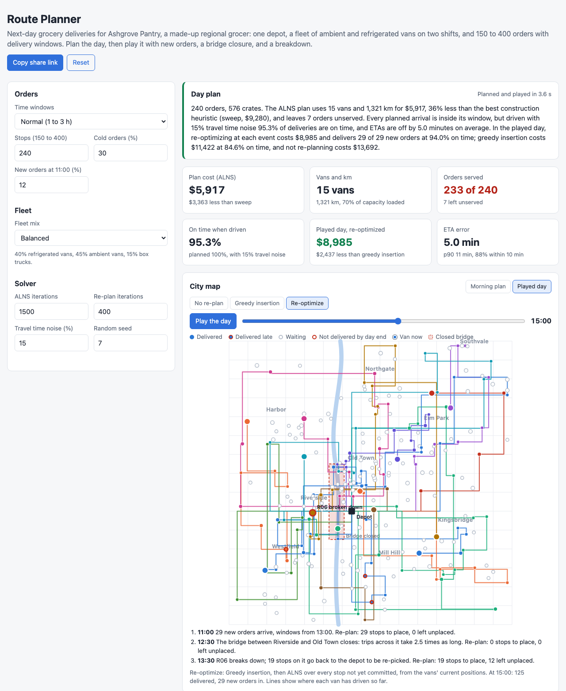

# Route Planner

A browser tool for last-mile delivery routing, the planning a grocery delivery operation runs every evening and again whenever the day goes wrong. It generates a day for a made-up regional grocer, Ashgrove Pantry: one depot, 150 to 400 orders spread over nine neighborhoods of a 30 by 30 km city grid, each with a delivery window, a service time, a number of crates, and in 30% of cases chilled items that need a refrigerated van. The fleet mixes ambient vans, refrigerated vans, and box trucks with their own capacity, cost per hour and per km, and an early or late shift. It builds routes with nearest neighbor, sweep, and Clarke-Wright savings, improves them with 2-opt, or-opt, relocate, and exchange, and then runs adaptive large neighborhood search (ALNS) with simulated annealing. Then it plays the day: the plan is driven with noisy travel times, 29 new orders arrive at 11:00, a bridge closes at 12:30, and a van breaks down at 13:30, and three re-planning strategies are compared on cost, on-time rate, and ETA accuracy.



## Why

Routing is where a delivery business makes or loses its margin. A van costs about $30 to $40 an hour with its driver, so one van fewer on a 240 order day is worth more than any discount on fuel. The hard part is not the distances but the constraints together: customers pick 1 to 3 hour windows and many pick the evening, cold orders must ride in the refrigerated vans, vans fill up, and drivers have shifts. Simple heuristics give a feasible plan in milliseconds, but a much more expensive one. And the plan meets reality an hour later: traffic, new orders, a closed road, a van in the shop. The question then is not "what is the optimal route" but "what do we change now, given where every van already is and what it is carrying". Each of these is a small model. This puts them on one day so they can be compared.

Results (seed 7, ALNS at 1,500 iterations, 15% travel time noise; every row is a fresh day):

| Scenario | Best construction | Savings + local search | ALNS | On time, driven | Played day: no re-plan / greedy / re-optimize |
|---|---|---|---|---|---|
| 240 stops, normal windows | Sweep, $9,280 | $8,592 | $5,917, 15 vans, 1,321 km, 7 unserved | 95.3% | $13,692 / $11,422 / $8,985 |
| 240 stops, tight windows | Sweep, $10,576 | $8,845 | $6,391, 19 vans, 3 unserved | 94.5% | $13,344 / $10,014 / $8,376 |
| 240 stops, loose windows | Sweep, $7,907 | $7,778 | $4,508, 14 vans, 0 unserved | 98.3% | $12,206 / $8,677 / $5,959 |
| 240 stops, small vans | Sweep, $8,237 | $8,272 | $5,450, 19 vans, 0 unserved | 99.2% | $12,240 / $9,524 / $7,334 |
| 400 stops, normal windows | Sweep, $13,439 | $15,061 | $7,929, 24 vans, 1 unserved | 97.7% | $18,713 / $14,294 / $12,562 |

Costs include van fixed cost, paid driver hours from shift start to return, km, overtime at 1.5x, $1.50 per minute late, and $150 per order not delivered.

What the default day shows:

- **Construction heuristics are fast and expensive.** Nearest neighbor, sweep, and savings each take 5 to 50 ms. The cheapest of them, sweep, needs 24 vans. ALNS takes about 2 seconds in the browser and serves the same orders with 15 vans for 36% less. Local search on top of savings takes 155 ms and cuts its cost by 17%, but still uses 21 vans, because 2-opt, relocate, and exchange move one stop at a time and cannot empty a route; removing a whole route and repairing it is what ALNS's route removal and regret insertion do.
- **A tight plan is a fragile plan.** Every planned arrival is inside its window, but driven with 15% noise per leg, 95.3% of deliveries are on time. ALNS packs vans to 70% of paid time, so a late leg early in the route has no slack to absorb it.
- **Re-optimizing beats greedy insertion by more than the extra compute.** Refusing the new orders and losing the broken van's stops costs $13,692. Inserting them greedily into the existing routes costs $11,422 and drops on-time to 84.6%, because the vans keep their sequence through the closed bridge. Re-optimizing everything not yet committed costs $8,985, delivers all 29 new orders, and keeps 94.0% on time, for about 2 seconds of ALNS over the three events.
- **ETAs drift along the route.** On a normal day the morning ETA is off by 5.0 minutes on average (p90 11.4). Stops 1 to 4 of a route are off by 3.4 minutes and stops 13 and later by 7.0, because errors add up leg by leg.

## How it works

```
 seed -> depot, 9 neighborhoods, stops (window, service time, crates, cold flag), new orders for 11:00
         fleet sized to the orders: van types x {early 07:00-16:30, late 11:30-21:00}
                                   |
   travel time = 2 min parking + Manhattan km / 30 km/h x congestion(hour of departure)
                                   |
   construction: nearest neighbor | sweep | Clarke-Wright savings (parallel, per vehicle class)
                                   |
   local search: 2-opt, or-opt (1 to 3 stops), relocate and exchange to the 15 nearest stops
                                   |
   ALNS: 4 destroy (random, worst, related, route) x 2 repair (greedy, regret-2),
         adaptive weights, simulated annealing, then local search on the best
                                   |
   play the day (noisy travel and service times, same draws for every strategy)
     11:00 new orders | 12:30 bridge closes | 13:30 van breaks down
     at each event: vans' current positions, committed stops fixed, crates on board
     -> no re-plan | greedy insertion | greedy insertion + ALNS
                                   |
   cost, km, vans, on-time rate, utilization, ETA error distribution
```

- **City and travel.** Stops cluster in neighborhoods (normal around a center) with 12% spread anywhere. Road distance is Manhattan distance on the grid. Travel time is 2 minutes of parking plus distance at 30 km/h, times an hourly congestion multiplier (1.55 at 08:00, 1.6 at 17:00, linearly interpolated), taken at the departure time. The closure multiplies time by 2.5 for legs whose straight line crosses the bridge area, from 12:30 on.
- **Constraints.** Capacity in crates, cold orders only in refrigerated vans, and the van must be back at the depot by its shift end. Planning treats windows as hard: arriving early means waiting, arriving late is not allowed. Re-planning allows up to 60 minutes late and 60 minutes of overtime, both priced into the cost, because during the day a late delivery is often better than none.
- **Cost.** Each van used pays a fixed cost, its driver from shift start to return (15 minutes to load, 5 to check in), and a cost per km. An order not served costs $150. Every heuristic minimizes this same objective.
- **Insertion.** Inserting a stop updates arrival times down the route and stops as soon as the departure time from a stop is unchanged (a wait at a window absorbed the shift), so most insertion checks are O(1) to O(k) rather than O(route length). A test checks this against full re-evaluation on 800 random insertions.
- **ALNS.** Each iteration removes 4% to 15% of stops (at most 40) with one of four destroy operators and reinserts them with greedy or regret-2 insertion. Simulated annealing starts where a 2% worse solution is accepted half the time and cools geometrically to 1/200 of that. Operator weights are updated every 100 iterations from scores of 33 (new best), 9 (better), and 13 (accepted worse).
- **Re-planning.** At each event every van is advanced to its next departure after the event time; the stop it is driving to or serving is committed. A van in the field keeps its crates: stops on board can only stay on that van, and any other stop it takes needs a reload at the depot first (20 minutes), modeled as a depot visit in its route. Vans at the depot can take anything. The broken van's stops go back to the depot to be re-picked. Greedy insertion keeps every van's order and inserts the new and orphaned stops; re-optimize then runs ALNS over all uncommitted stops.
- **ETAs.** Each leg's actual time is the predicted time times a lognormal factor with mean 1 (15% sd by default), drawn from a hash of the seed and the leg, so every strategy sees the same traffic. The predicted ETA is the one from the latest plan before the van left for the stop.

The engine is `src/vrp.js` with no DOM code. `src/run.js` runs the five algorithms, a normal day, and three played days, and `src/worker.js` runs it in a Web Worker so the page stays responsive. Coordinates and noise factors are rounded so that results are identical in Node and in browsers: ALNS amplifies any last-digit difference in `Math.log` or `Math.cos` between JavaScript engines into a different search path.

## What you see

- **Day plan** in a few sentences, and tiles for plan cost, vans and km, orders served, on-time when driven, the played day, and ETA error.
- **City map** with the depot, the river and bridge, neighborhoods, stops colored by van, and routes drawn along the street grid. Switch between the five algorithms, or to the played day with a time slider and a "Play the day" button that shows vans moving, deliveries turning from pending to delivered or late, the closed bridge, and the broken van.
- **Van timelines**: one row per van with its shift, deliveries (green on time, red late), waiting for windows, and each stop's window as a line under its delivery. In the played day, the three events and the current time.
- **Algorithm comparison**: cost, km, vans, unserved, load and time utilization, on-time when driven, and compute time. Click a row to map it. Below it, the ALNS cost by iteration and which operator pairs found new bests.
- **Re-planning table**: day cost, delivered orders, new orders delivered, on-time, late minutes, overtime, km, and compute time for each strategy, with the event log.
- **ETA accuracy**: histogram of actual minus predicted arrival for a normal day or the played day, and the error by stop position.

Window tightness, number of stops, cold share, new order share, fleet mix, ALNS and re-plan iterations, noise, and the seed are editable. All settings live in the URL hash, so a scenario can be shared as a link. Light and dark mode follow the system. Hover stops, timeline blocks, and histogram bars for details.

## Run it

It is a static site with no build step and no dependencies. ES modules need a web server, so `file://` will not work. From this folder run:

```bash
python3 -m http.server 8000
```

Then open http://localhost:8000.

## Tests

```bash
npm test        # or: node --test
```

37 tests cover the engine:

- RNG and hash determinism, a problem that is reproducible from the seed, stops, windows, demand, and cold share in range, and a fleet with enough refrigerated capacity and both shifts.
- Congestion by hour and its interpolation, the travel time formula, and the closure slowing only legs that cross it and only after 12:30. Segment and box intersection.
- A one-stop route timed and costed by hand. Feasibility: capacity, time windows (infeasible when planning, penalized when re-planning), refrigerated vans for cold orders, and shift length. The solution checker catching missing and duplicate stops.
- The fast insertion cost equal to a full re-evaluation on random insertions, with hard and soft windows.
- Nearest neighbor, sweep, and savings each producing feasible routes with each stop once, deterministically. Greedy and regret insertion from scratch.
- 2-opt, or-opt, relocate, and exchange never increasing cost and keeping every route feasible, from three different starts. Local search improving savings. ALNS beating the best construction by more than 5%, deterministic, with a best cost that never rises.
- Summary metrics adding up. Execution with no noise matching the plan exactly, noise with mean 1 that is the same for every strategy, and ETA error accounting on a hand-built set.
- The dynamic day: the morning identical under every strategy and equal to the start of the plan (committed stops kept), each stop served at most once with served plus unserved equal to all orders, the broken van stopping at the breakdown, new orders refused without re-planning and served with it, re-optimizing no more expensive than greedy insertion, and a deterministic day.
- Config clamping and URL round trip.

## CI and deploy

`.github/workflows/ci.yml` runs `npm test` on Node 22 for every push and pull request. On push to `main` a second job publishes the site to GitHub Pages with `actions/upload-pages-artifact@v3` and `actions/deploy-pages@v4`. Set Pages to "GitHub Actions" as the source in the repo settings. The workflow has not been run locally.

## When to use a dedicated solver

The solvers here are a few hundred lines of JavaScript and are good enough to show the trade-offs and to plan a few hundred stops. A real operation should move to a dedicated solver when:

- **Scale or time limits grow.** At thousands of stops per depot, or when a plan must be ready in seconds after order cutoff, a tuned solver with good neighborhoods, incremental evaluation, and parallel search finds better plans in the same time. Google OR-Tools (free, open source) handles capacities, time windows, pickup and delivery, and vehicle-specific costs. Commercial solvers (for example Hexaly, or MIP solvers such as Gurobi for exact sub-problems) and routing services go further.
- **Constraints multiply.** Driver breaks and legal driving hours, multiple depots, multi-trip vans, loading order, skills, customer priorities, access restrictions, and pickups make hand-written move evaluation slow to build and easy to get wrong. A solver models these as dimensions and constraints.
- **You need a bound.** ALNS gives a good plan but not a proof of how good. A MIP or column generation lower bound tells you whether 2% more is available or the plan is already close to optimal, which matters when routing cost is a large line item.
- **Travel times are real.** Real road networks are not grids: one-way streets, turn restrictions, and time-dependent speeds by road segment need a routing engine (OSRM, Valhalla, or a commercial map API) to build the time matrix. The solver then consumes that matrix.

Keep a simple heuristic, like the greedy insertion here, as the fallback the dispatcher can always run if the solver times out.

## Production notes

- Build the travel time matrix from a road network and historical speeds per segment and hour, not Manhattan distance and one congestion curve, and re-estimate ETAs from live GPS positions instead of the plan.
- Run the evening plan as a batch job with a time limit after order cutoff, and re-planning as a service called on events (new order, delay over a threshold, breakdown), with the dispatcher approving changes to routes already on the road.
- Price delivery slots from the plan: the marginal cost of inserting an order into each window tells the website which slots to offer or discount, which reduces the evening peak that drives the fleet size here.
- Learn service times per customer and building type, and model noise per leg from history; then plan with a buffer per stop that targets an on-time rate instead of hard windows on expected times.
- Log every plan, re-plan, and actual arrival, so that solver changes can be evaluated offline on real days before they reach drivers.

## License

MIT. See [LICENSE](LICENSE).
